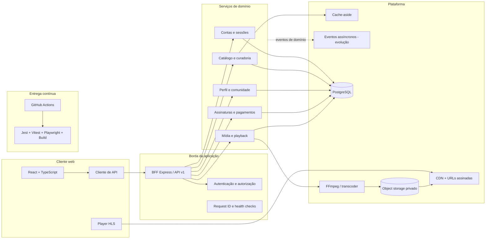

# Arquitetura web do Cinevault

## Objetivo

Esta arquitetura adapta a referência de uma plataforma de streaming de grande escala ao estágio atual do Cinevault. Ela cobre somente a aplicação web responsiva. Não inclui aplicativos nativos para iOS, Android ou TV.

O objetivo é manter o produto simples para desenvolvimento local e, ao mesmo tempo, criar fronteiras que permitam escalar cache, eventos, dados e entrega de vídeo sem reescrever as regras de negócio.

## Visão geral



## Correspondência com a referência

| Referência | Cinevault web | Decisão |
| --- | --- | --- |
| Web JavaScript + React | React, TypeScript e Vite | Mantido; é o único cliente desta fase. |
| GraphQL | API HTTP tipada por contratos compartilhados | REST/BFF é mais simples com um único cliente. GraphQL pode ser adicionado como adaptador quando houver mais consumidores ou composição complexa. |
| Zuul e Eureka | BFF Express com rotas e composição explícita | Service discovery não traz benefício enquanto os domínios rodam no mesmo processo. |
| Spring Boot services | Módulos de domínio TypeScript | O monólito modular preserva fronteiras sem o custo operacional de microserviços prematuros. |
| EVCache | Interface `CacheStore` com implementação local | Permite desenvolvimento sem infraestrutura e futura troca por Redis. |
| Cassandra e MySQL | PostgreSQL | É a fonte transacional única atual e atende catálogo, usuários, comunidade e pagamentos. |
| Kafka e Flink | Porta para eventos de domínio, em fase posterior | Só será introduzida quando houver processamento assíncrono que justifique operação e monitoramento próprios. |
| S3 e CloudFront | Object storage S3 compatível, CDN e URLs HMAC | Já suportado pelo pipeline de mídia. |
| Elastic Transcoder | FFmpeg local, substituível por transcoder gerenciado | Gera HLS adaptativo em 360p, 720p e 1080p. |
| Jenkins/Spinnaker | GitHub Actions | Executa qualidade automatizada a cada push e pull request. |

## Regras arquiteturais

1. O navegador conversa apenas com o BFF; nunca acessa PostgreSQL ou object storage privado diretamente.
2. Os contratos públicos vivem em `packages/shared-types` e não dependem de Express, PostgreSQL ou React.
3. Autenticação, catálogo, comunidade, pagamentos e mídia permanecem módulos separados, mesmo executados no mesmo processo.
4. Playback nunca é cacheado: cada autorização deve validar sessão, conteúdo e assinatura vigentes.
5. O catálogo usa cache-aside com TTL curto e proteção contra cache stampede.
6. Vídeos são entregues como HLS por object storage/CDN usando URLs temporárias; o BFF não deve carregar o arquivo inteiro em memória.
7. Novos componentes de infraestrutura entram por interfaces e configuração, não por chamadas espalhadas nos controladores.
8. Um domínio só deve virar microserviço quando houver necessidade independente de escala, implantação ou isolamento de falhas.

## Fluxos principais

### Catálogo

```text
React → BFF autenticado → cache do catálogo → serviço de catálogo → PostgreSQL
```

O cache reduz leituras repetidas e protege o banco durante picos. Requisições simultâneas para a mesma chave compartilham uma única consulta, evitando stampede.

### Reprodução

```text
React → autorização no BFF → URL HLS assinada → CDN/object storage → player HLS
```

A autorização permanece dinâmica e fora do cache para que assinatura, plano e publicação sejam avaliados no momento da reprodução.

### Upload e transcodificação

```text
Admin web → BFF → job de mídia → FFmpeg → playlists/segmentos → object storage → CDN
```

O processamento local atende desenvolvimento. A interface de armazenamento permite usar S3, R2 ou MinIO sem alterar o painel administrativo.

## Evolução planejada

1. Cache local com a interface definitiva e proteção contra stampede.
2. Adaptador Redis e invalidação por eventos de catálogo.
3. Telemetria de reprodução e métricas de experiência do usuário.
4. Fila durável para transcodificação e notificações.
5. CDN de produção, DRM e observabilidade distribuída.
6. GraphQL somente se novos clientes ou consultas agregadas justificarem a camada.

## Critério para a fase web atual

A fase está correta quando o React continua funcional, os contratos HTTP permanecem compatíveis, o catálogo usa cache substituível, playback não é cacheado, o pipeline HLS continua isolado e toda alteração passa por testes e build no CI.
